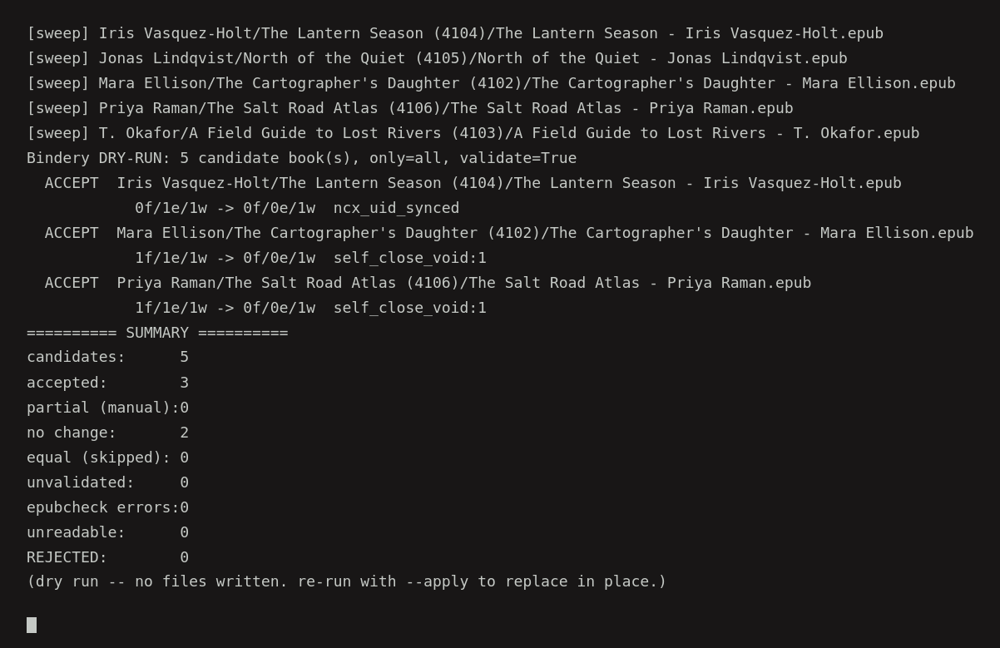

<div align="center">
  
  <h1>bindery-cli</h1>
  <p>Audit EPUB body text and repair broken EPUBs with safe, deterministic fixes, validated by epubcheck, with optional in-place replacement in a Calibre library.</p>
</div>

<p align="center">
  
</p>

**Status: stable (1.0).** The flag surface is additive from here. New opt-in flags may
appear; existing flags keep their names and documented behavior; the gate and the JSON
record shapes are the contract. The details are in the
[1.0 stability contract](spec.md#the-10-stability-contract-2026-11-05).

## Contents

- [Quick start](#quick-start)
- [What it fixes](#what-it-fixes)
- [The safety contract](#the-safety-contract)
- [Install](#install)
- [Repairing a book](#repairing-a-book)
- [Sweeping a library](#sweeping-a-library)
- [Auditing](#auditing)
- [Observing a library](#observing-a-library)
- [Run slices](#run-slices)
- [The Calibre plugin](#the-calibre-plugin-bindery-repair)
- [Which flag for which epubcheck error](#which-flag-for-which-epubcheck-error)
- [Exit codes](#exit-codes)
- [Troubleshooting](#troubleshooting)
- [Companion scripts](#companion-scripts)
- [Development](#development)
- [License](#license)
- [Support](#support)

## Quick start

```sh
uv tool install bindery-cli                 # Python 3.12+; epubcheck must be on PATH
bindery doctor                              # checks the installation; always exits 0
bindery repair broken.epub                  # probe: report what a repair would change
bindery repair broken.epub fixed.epub       # write the repaired file
bindery library ~/MyLibrary --only fatals --sweep             # dry run over a Calibre library
bindery library ~/MyLibrary --only fatals --sweep --apply --backup ~/bindery-backups
```

Nothing is written without an output path (`repair`) or `--apply` (`library`), and every
repair is checked with epubcheck before it is kept.

## What it fixes

bindery-cli makes accidentally broken markup well-formed again. It does not rewrite or
reflow content. The **default pass** applies only a small set of deterministic,
semantics-preserving well-formedness fixes that real-world EPUBs (especially Calibre
conversions) trip over. Nothing else changes without an explicit flag:

- **Unclosed void elements** (`<link>`, `<br>`, ``, ...) get self-closed.
- **Undeclared named entities** (`&nbsp;`, `&deg;`, `&eacute;`, ...) become numeric
  character references that every XML parser understands.
- **Bare `&`** (common in `toc.ncx`) is escaped to `&amp;`.
- **Junk before the XML prolog** (BOM, stray bytes) is stripped.
- **Duplicate `xmlns`** on the root `<html>` is collapsed to one.
- **NCX-001**: `toc.ncx` `dtb:uid` is synced to the OPF unique identifier. Duplicated
  NCX `playOrder` values are resequenced whenever the NCX is processed.
- **mimetype** is rewritten first and stored. A missing entry is added, and wrong or
  whitespace-padded content is normalized.

### Opt-in repairs

The remaining 45 fixes are opt-in: off until their flag is passed, or all at once via
`--all`. They go further than well-formedness (altering structure or adding minimal
content), so they never run by default. They group the way the CLI help groups them:

- **Safe opt-ins** (6): `--fix-ids`, `--add-img-alt`, `--reserialize`,
  `--strip-bad-attrs`, `--escape-unknown-entities`, `--fix-double-colon-tags`.
- **Structural repairs: markup and nesting** (13): from `--fix-empty-body`,
  `--fix-missing-title`, and `--fix-id-colons` to the mis-nest, stray-close, and
  unterminated-attribute family, the EPUB 2 downgrades, and
  `--strip-presentational-attrs`.
- **Structural repairs: references and resources** (11): the prune, declare, and
  encode family, from `--prune-missing-resources` and `--encode-url-spaces` to
  `--strip-dead-font-faces` and the `--prune-dead-spine` shell repair.
- **Structural repairs: package wiring** (11): `--fix-container` (the gateway
  defect), `--fix-media-types`, `--declare-missing-items`, `--fix-cover`,
  `--fix-unique-identifier`, and the OPF version, doctype, and guide family.
- **Lossy strips** (4), which stand apart because they delete converter-injected
  content rather than correct XML:

  - **`--strip-pagination`**: remove print page numbers and running headers that a
    PDF or OCR conversion baked into the body text as literal paragraphs (so they
    reflow into the middle of a sentence: "where the hay cart **16** was taking him").
    Roman chapter numbers, page-list anchors, and years are preserved. Every removal
    requires prose flow, and four safety nets guard every edit.
  - **`--strip-broken-tags`**: remove leaked HTML closing tags missing their open
    brackets (for example `</p>`) that render as raw text.
  - **`--strip-watermarks`**: remove known producer and distributor watermarks
    (OceanofPDF, ABC Amber LIT Converter) and stray marker files, deleting only
    wrappers whose entire visible text is the stamp.
  - **`--strip-stub-docs`**: drop spine documents whose whole body is the same short
    placeholder repeated across the spine (the Bookmate-style export), and cascade the
    drop through the archive, manifest, spine, and table of contents. A book whose
    *every* spine document is the stub is refused: it needs a re-source, never a repair.

[docs/repairs.md](docs/repairs.md) is the full reference for every flag: its rules, its
refusals, and where it runs. It is the same text `bindery repair --help-repairs`
prints, and `bindery repair --help` lists the one-line summaries.

## The safety contract

Every repair is gated by [epubcheck](https://github.com/w3c/epubcheck). The acceptance
rule has two modes, because a fatal parse error makes epubcheck stop reading a file and
hides every error after it:

- If a book **had fatals**, success means **fewer fatals**. The error count may rise as
  previously hidden errors become visible once the file parses. That is the book going
  from "will not open" to "opens with nits", not a regression.
- If a book had **no fatals**, an error increase is a real regression, so a strict
  error decrease is required.

Introducing a new fatal is always rejected. The lossy strips cannot show a gain to
epubcheck (a baked-in page number is valid markup), so they are accepted when the
result is **no worse** instead: no new fatals, no new errors. Three structural flags
are held to the same no-worse bar because their gains sit where epubcheck's counts do
not look: `--fix-cover`, `--encode-url-spaces`, and `--fix-media-types`.

One structural check rides above the counts. The repairer compares how much of the
book's spine resolves before and after (reading-order entry, to manifest item, to
archive file). A candidate whose spine resolves worse than the original is rejected
whatever the counts say: one that leaves more reading-order entries dangling, or, after
a dead-spine prune, one that resolves less than half the documents the original did.
A repair that throws away broken documents can look like an error reduction, and that
check is what stops it.

If epubcheck itself fails to run (crash, timeout, unparsable output), the book is
reported as an error and never applied. Only an explicit `--no-validate` skips the
gate. Originals are never modified except by an explicit `--apply`, and even then only
after the gate accepts the result.

## Install

Python 3.12+, plus epubcheck on `PATH` for the gate. Dependencies: `tqdm` for progress
output, plus the VirInvictus libraries `vir-tui` (TUI rendering) and `cquarry`
(read-only Calibre database access), which install on Python 3.14+ only. `html5lib` is
an optional extra, needed only for `--reserialize`.

```sh
uv tool install bindery-cli                            # core tools
uv tool install "bindery-cli[reserialize]"             # incl. --reserialize
```

epubcheck (W3C's conformance checker) is the gate's oracle and the one dependency pip
cannot install for you. It needs a Java runtime. Any of these works:

- your package manager, where it ships: `apt install epubcheck` (Debian/Ubuntu),
  `brew install epubcheck` (macOS), `epubcheck` in the AUR (Arch); or
- the release zip from [w3c/epubcheck](https://github.com/w3c/epubcheck/releases):
  unzip it and put its `epubcheck` launcher script somewhere on `PATH`.

Verify with `epubcheck --version`. A validated run refuses to start without it (exit 1,
"epubcheck not found") rather than silently skipping the gate.

`bindery doctor` runs all of these checks for you. It reports the Python stack tier,
the epubcheck version, Java, the optional html5lib, and whether a Calibre library is
discoverable from the current directory. It always works and always exits 0; the
findings are the output.

The floor is two-tier. On Python 3.14 everything runs. On 3.12 and 3.13 the install
carries the repair core only: `bindery repair` on a single EPUB works in full, while
`bindery audit`, `bindery library`, and `bindery run` print a one-line note that the
command needs the Python 3.14 stack.

## Repairing a book

Repair one book to a new file. The gate runs, and an accepted repair is written to
the output path. One known limitation: a result that changes the book's bytes
without changing its epubcheck counts is written too. Without an output path the
command is a probe: the gate still
runs, the report says what would change, and nothing is written.

```sh
bindery repair broken.epub                              # probe: nothing written
bindery repair broken.epub --all --json report.json     # probe with a machine-readable record
bindery repair broken.epub fixed.epub                   # write the repaired file
bindery repair scanned.epub --strip-pagination          # also remove baked-in page numbers
bindery repair stubs.epub --strip-stub-docs             # drop repeated placeholder chapters
bindery repair broken.epub fixed.epub --force           # overwrite an existing output
```

`repair --json FILE` writes one record in the same per-book vocabulary `library --json`
uses: `status`, `applied`, the before and after counts, the fix `summary`, and a
structured breakdown of every fix that fired. It is written on every outcome,
including nothing-to-do and rejected. On a probe, `output` is null and `applied` is
false.

## Sweeping a library

Scan a Calibre library and see what would be fixed, writing nothing:

```sh
bindery library ~/MyLibrary --only fatals --sweep
```

Apply accepted repairs in place, atomically, with backups:

```sh
bindery library ~/MyLibrary --only fatals --sweep --apply --backup ~/bindery-backups
```

Repair a few books by Calibre id, including the lossy strips, and register the result
with Calibre (close Calibre first):

```sh
bindery library ~/MyLibrary --id 5071,5072 --sweep --only all --apply --all --install-to-calibre
```

- `--only {fatals,ncx,all}` restricts the candidate set. `fatals` needs `--sweep` or
  `--audit`; `ncx` targets the NCX-001 mismatch.
- `--id IDS` limits the sweep to a comma-separated list of Calibre book ids from that
  library.
- `--sweep` selects candidates with a live epubcheck run and reuses each result as
  that book's "before" measurement, so no book is checked twice. `--audit CSV` takes
  the `fatals,errors,warnings,path` file a previous sweep produced instead. A CSV that
  matches nothing triggers a loud warning instead of silently selecting zero books.
- `--limit N` processes at most N candidates. `--workers N` runs that many epubcheck
  checks at once during the sweep; the repair step itself is always serial, because
  that is where files are replaced.
- `--all` turns on every opt-in flag, including the four lossy strips.
- `--apply` is required to write; the default is a dry run. Only the `.epub` is
  replaced, atomically (a temp file in the same directory, then a rename), with the
  file's mode preserved. `metadata.opf`, `cover.jpg`, and `metadata.db` are left for
  Calibre to reconcile.
- `--backup DIR` mirrors originals there before replacing (`DIR/<book folder>/file.epub`);
  `--backup-inplace` writes `file.epub.bak` beside each file instead. The first backup
  of a book is never overwritten. `--backup-keep N` (minimum 2) bounds the rotation to
  N backup files per book, so repeated applies cannot pile up backup files. The
  first `.bak` is never deleted.
- `--install-to-calibre` registers the repaired EPUB as the book's format in
  `metadata.db` instead of only replacing the file, so Calibre's stored size stays
  truthful. The book id is resolved from the catalog; a file the catalog does not
  know is saved in place and the catalog is left alone. This is refused with exit 1
  while Calibre is running.
- `--json FILE` writes a machine-readable report of the whole run, and
  `--manual-list FILE` writes the paths of every book that was not auto-repaired, one
  per line, ready for manual follow-up.
- A per-book progress line goes to stderr (stdout stays a clean report); `--quiet`
  suppresses it. A corrupt or unreadable book is reported and skipped, never aborting
  the sweep.

## Auditing

`bindery audit` inspects EPUB body text for flaws epubcheck cannot catch, without
touching anything. Its reports tell you which books to repair and which to re-source.

```sh
# Detect non-English content (e.g., Cyrillic or CJK in an English library)
cd ~/MyLibrary && bindery audit content

# Find books with hardcoded print page numbers interrupting the text
bindery audit pagenumbers ~/MyLibrary

# Find books that are empty or severely truncated
bindery audit emptytext ~/MyLibrary

# Find books with severe OCR damage (garbage characters, excessive hyphenation)
bindery audit ocr ~/MyLibrary

# Flag books where a single content document is too large for readers to render
bindery audit monolithic ~/MyLibrary

# Spot-check completeness: prose coverage, first/middle/last excerpts, trailing ToC
bindery audit completeness ~/MyLibrary

# Cover-art wiring and ToC drift between the NCX and the EPUB 3 nav (advisory)
bindery audit cover ~/MyLibrary
bindery audit tocdrift ~/MyLibrary

# Fan-bundle contamination: foreign-title template stamps, ad pages, review paste
bindery audit contamination ~/MyLibrary

# Detect shell books: a manifest that names mostly files the archive never carried
bindery audit shell ~/MyLibrary

# Run every audit and report to the console
bindery audit all ~/MyLibrary
```

A directory of loose `.epub` files works too (`bindery audit pagenumbers
/path/to/loose/epubs`), and one or more library books can be audited by Calibre id
(`cd <library> && bindery audit all --id 1234,1235`). `--json FILE` writes the
verdicts machine-readably.

Tagging is the audit's only write path, and it is opt-in. `--tag "Audit Flagged"` tags
every flagged book, and the write is refused with exit 1 while Calibre is running:
close Calibre and re-run.

The analyzer detail (thresholds, the `--json` shape, spine and archive integrity
verdicts, the tagging contract) is in [docs/audits.md](docs/audits.md).

## Observing a library

`bindery observe` is the whole-library census. One pass validates every EPUB, clean
books included, for epubcheck counts and error codes together. The result is tabulated
(a severity histogram, the dominant error codes, the worst offenders), and one
`.observe` file carries the per-book rows so later questions can be answered without
validating again:

```sh
bindery observe ~/MyLibrary --output ~/observe/base.observe
bindery observe ~/MyLibrary --output ~/observe/next.observe --against ~/observe/base.observe
```

- Strictly read-only: the only file written is the `.observe` file, and the writer
  refuses to put it inside the scanned folder. The default output is
  `observe-<timestamp>.observe` in the current directory.
- The repair preview (on by default; `--no-preview` skips it) measures what a dry-run
  `library` sweep with the default flags would do to each candidate. It never writes.
- `--against FILE` adds a trend block: library totals, error-mass delta, and per-code
  changes with `new_codes` and `resolved_codes`. Artifacts are versioned; a schema
  mismatch is a usage error, never a silently incomparable trend.
- Two counting scales are stated in the artifact's `counting` block. `codes.messages`
  counts epubcheck's aggregated messages, one per distinct defect text, which is the
  scale the repair gate measures. `codes.occurrences` counts sites, the scale
  epubcheck's text summary reports. One book can differ by orders of magnitude between
  the two.
- A book the checker cannot read arrives as a sentinel record instead of being
  dropped, and a run that comes back short refuses to write a partial census. `.caltrash`
  is skipped.

## Run slices

`bindery run` composes the EPUB steps of an acquisition pipeline. The two verbs add no
repair classes of their own: they run the shipped audit and library commands in the
documented order, and both speak `--json` for a calling program.

**`run phase1 DIR`** vets a directory of loose files before import. It runs the audit
battery (corruption, content, oversized documents) in one pass per book, then the gated
repair sweep over the same directory. The verb is read-only until `--apply-lossy` is
passed, and that flag is the recorded consent for the lossy strips; `--backup DIR`
mirrors originals first (keep backups outside the vetted directory). Consent questions
never block the run: a read-only run that finds repairable books records an
`apply_lossy` entry in the JSON's `decisions_needed` instead of prompting, and
`--non-interactive` declares that contract for callers.

```sh
bindery run phase1 ~/Downloads --json phase1-report.json               # read-only
bindery run phase1 ~/Downloads --apply-lossy --backup /tmp/phase1-backups
```

**`run phase3 --ids IDS`** (from the library directory) is the scoped repair after
import: exactly `library <that library> --id IDS --sweep --only all --apply --all
--install-to-calibre`, plus a before-and-after epubcheck summary. It refuses an
unscoped library-wide sweep with exit 2 (a full-library sweep is a dedicated hours-long
task, never a verb call), and books left partial or unreadable surface as
`decisions_needed` in the JSON.

```sh
cd ~/MyLibrary && bindery run phase3 --ids 5071,5072 --json phase3-report.json
```

## The Calibre plugin (Bindery Repair)

Each release also ships **BinderyRepair-v\<VERSION\>.zip**, a Calibre plugin that
repairs EPUBs as they are imported. It is attached to the GitHub release beside the
PyPI wheel; load it through Calibre's Preferences, Plugins, "Load plugin from file".

The plugin runs only the default pass: the five well-formedness fixes, the NCX
pipeline, and the mimetype fix. epubcheck cannot run inside Calibre, so no opt-in
repair ever runs there. The structural repairs and the lossy strips stay on the
command line, where the gate can judge them. The default pass is the
semantics-preserving set, and it is safe on its own. Minimum Calibre 7.0, Linux.
Behavior guarantees, the JSON configuration string, and compatibility notes are in
[docs/plugin.md](docs/plugin.md).

## Which flag for which epubcheck error

Run a probe (`bindery repair book.epub`) or a dry-run sweep to see a book's codes,
then start with the flag that addresses them. When in doubt, `--all` turns on every
opt-in flag: the gate rejects any candidate that does not improve the book, so nothing
is applied unless epubcheck agrees.

| epubcheck says | Start with |
|---|---|
| The package document cannot be found (`container.xml` missing or naming the wrong file) | `--fix-container` |
| RSC-016: XML parse error in the OPF ("prefix is not bound") | `--fix-unbound-prefix` |
| RSC-016: parse error in a content document | `--fix-double-colon-tags`, `--fix-comment-double-hyphen`, `--fix-unterminated-attr`, `--fix-stray-close` |
| RSC-005: invalid or duplicate id | `--fix-ids`, `--fix-id-colons`, `--fix-duplicate-ids` |
| RSC-005: element or attribute not allowed | `--add-img-alt`, `--unwrap-block-in-inline`, `--strip-invalid-value`, `--unwrap-illegal-tags` |
| RSC-005: EPUB 3 markup in an EPUB 2 book | `--strip-epub3-attrs`, `--downgrade-epub3-tags` |
| RSC-007: referenced resource not found | `--prune-missing-resources`, `--prune-dangling-ncx-targets`, `--strip-dead-font-faces` |
| RSC-008: resource not declared in the manifest | `--declare-missing-items` |
| RSC-001: file not found (a `#` or `?` inside the file name) | `--encode-ref-delims` |
| RSC-020 / PKG-010: invalid URL (spaces, brackets) | `--encode-url-spaces`, `--encode-ref-brackets` |
| RSC-020 / RSC-012: broken fragment link | `--strip-broken-anchors` |
| OPF-001: unparsable EPUB version | `--fix-package-version` |
| OPF-029: wrong media type | `--fix-media-types` |
| OPF-030: unique identifier not found | `--fix-unique-identifier` |
| OPF-014: property should be declared (EPUB 3) | `--fix-item-properties` |
| OPF-032: guide reference is not a content document | `--prune-invalid-guide-refs` |
| HTM-004: irregular DOCTYPE | `--fix-doctype` |
| CSS-008: premature end of file in a stylesheet | `--fix-cdata-terminator` |
| NCX-001: `dtb:uid` mismatch | none: the default pass syncs it |

Two shapes are not repair errors. A **shell book** (half or more of the manifest names
files the archive never carried) has lost its content; `bindery audit shell` names it
and it needs a re-source. If those files are present but their references carry a raw
`#` or `?`, the fix is `--encode-ref-delims`, not a re-source. Each flag's rules and
refusals are in [docs/repairs.md](docs/repairs.md).

## Exit codes

| Command | 0 | 1 | 2 | 3 |
|---|---|---|---|---|
| `repair` | clean, probed, or written (a partial repair writes its output too) | trouble: gate-rejected, epubcheck failure, unreadable input, or a usage problem | never | |
| `library` | clean | usage problem | any book rejected, errored, unreadable, or partial | |
| `audit` | clean | findings | usage or environment error | findings, and the `--json` or `--tag` write failed |
| `observe` | artifact written | usage problem | the census failed mid-run | |
| `run phase1` | clean | usage problem | any book flagged, rejected, partial, errored, or unreadable | |
| `run phase3` | clean | usage problem | as `library`, or the sweep was unscoped | |
| `doctor` | always | | | |

Misused command-line syntax exits 2 everywhere, before anything is validated. Two
doors write through Calibre's database and are refused with exit 1 while Calibre is
running: `audit --tag`, and `library --apply --install-to-calibre`. A book that is
still broken after its best repair (a **partial** result) counts as trouble in every
library and run verb: a book that still needs a human is reported, not passed.
`bindery --help-json` carries this table machine-readably.

## Troubleshooting

**"epubcheck not found" (exit 1).** Install epubcheck and make sure it is on `PATH`
([Install](#install)). `bindery doctor` shows what is missing. `--no-validate` skips
the gate for a single-file repair; the result is then unverified.

**Exit 1 with a message that Calibre is running.** `audit --tag` and
`--install-to-calibre` write through `metadata.db`. Close Calibre and re-run.

**A book comes back `partial`.** The repair improved it, but epubcheck still reports a
fatal, so nothing was applied to your library. The book is on the `--manual-list`; it
needs a person, or a re-source.

**A book comes back `reject`.** The gate refused the candidate: it did not improve the
book, or it damaged the spine. The summary names the reason, for example
`(spine collapse)` or `(spine halved)`. Try the single flag for its error class
([above](#which-flag-for-which-epubcheck-error)) instead of `--all`.

**`(epubcheck timeout)`.** epubcheck did not finish inside the book's budget. Large
and entry-heavy books get a larger budget automatically (up to 30 minutes). Run the
book on its own, without `--workers`, and try again.

**`audit`, `library`, or `run` refuses with exit 2 on Python 3.12 or 3.13.** Those
commands need the Python 3.14 stack. `bindery repair` on a single file works in full.

**`--reserialize` reports html5lib missing.** Install the extra:
`uv tool install "bindery-cli[reserialize]"`.

## Companion scripts

`scripts/` holds standalone, read-only utilities that are useful for EPUB maintenance
but fall outside the repair contract:

- `fast_sweep.py`: a parallel epubcheck sweep that starts the JVM once instead of once
  per book (from a subprocess loop epubcheck costs about three seconds a book, roughly six
  hours for a 7,000-book library; this script turns that sweep into minutes). `--mode=audit` emits the
  `fatals,errors,warnings,path` CSV that `bindery library --audit` reads, with counts
  taken from the same scale the gate measures, so selection and gating always agree.
  `--mode=extract` emits per-book error codes for aggregation (`--summary` prints the
  per-code report). The epubcheck jar is located from the `epubcheck` launcher or from
  `EPUBCHECK_JAR`.

## Development

```sh
./run_tests.sh        # ruff (CI's pin) + the unittest suite
```

The suite builds its own synthetic EPUBs and needs no Calibre library. The contract is
[spec.md](spec.md); programmer-facing rules, decisions, and the module map are in
[AGENTS.md](AGENTS.md); [roadmap.md](roadmap.md) holds the plan.

Reference pages: [docs/repairs.md](docs/repairs.md) for every opt-in flag,
[docs/audits.md](docs/audits.md) for the audit analyzers, and
[docs/plugin.md](docs/plugin.md) for the Calibre plugin.

## License

MIT. See [LICENSE](LICENSE).

## Support

If bindery-cli is useful to you and you'd like to chip in:

- liberapay: [liberapay.com/bdkl](https://liberapay.com/bdkl/)
- bitcoin
  ```
  bc1qkge6zr45tzqfwfmvma2ylumt6mg7wlwmhr05yv
  ```
